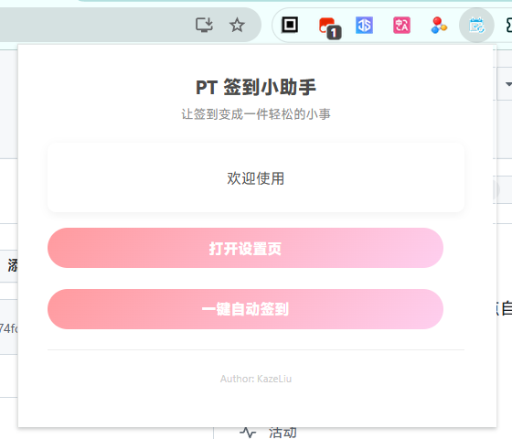

这里将一步一步告诉你如何使用本软件

## 第一步 ，点开图标，在里面点击`打开设置页`

## 添加页详解
在设置页面中点击`站点设置`，在右侧的添加按钮中点击`添加新站点`

- **快速预设** 这是快速添加站点，用于不喜欢看文档的人点两下应该就会使用新增站点了
- **站点名称** 站点名称自定义，想叫啥就叫啥，作为主键使用，不能重复（我好像忘记写重复判定了）
- **站点类型** 这个是重点，选错了就会签到失败,由于有些站的不可说属性，我只拿通用的出来解释
  - ONLINE：适用于馒头等不签到的站，主要是我看到有些人忘记在几个月内上线导致被封号，就添加了一个这个，签到的时候顺便访问一下页面，以免太久没上号被封号
  - nexusPHP：适用于所有使用`/attendance`作为签到页面的nexusPHP的站  
  - 其他：你们自己去通过名字去匹配
- **签到地址** 填写签到地址，这个地址是站点的签到按钮的链接或者是签到页面的网址，我会在下面介绍
  - ONLINE：反正只是访问一下，填写站点主域名就行
  - nexusPHP：填写完整的地址，就是点击签到后跳转的页面的地址，比如大青虫就填写：`https://cyanbug.net/attendance.php`
  - PTT：地址填写`https://www.pttime.org/attendance.php`
  - 其他：一部分是填写`签到按钮所在的网址`，一部分是填写`签到后跳转的页面的地址` (我真的很想直接贴网址，但是不清楚哪些是不可说)
- **是否跳过验证** 通过页面关键字来判定当前页面是否是等待验证的页面，如果启用，就不会去查看页面是不是有关键字。*因为有些签到页上会有关键字（比如cloudflare），导致页面是网站签到页但是会被判定为等待页，然后就会超时然后返回签到失败（其实是签到成功了），所以有这种情况的就需要关闭*
- **前台激活页面** 打开后，当前页面签到就会在前台打开，会打断电脑正常使用，用于cloudflare验证，如果你感觉放在后台盾也不会拦截，那就不需要打开
- **是否启用** 在签到主页中是否显示该站点
- **我的站点需要定制签到流程** 我没有的站那肯定是没有对应的签到流程了，毕竟不知道签到长啥样

## 站点类型和签到地址的详细解释：
例如 Rousi 不使用通用的 `nexusPHP` 策略。站点类型选择 `ROUSI`，签到地址填写 `https://rousi.pro/`，插件会点击新版首页的快捷签到按钮，领取固定奖励。已有站点保留原名称即可。

Rousi 页面出现“已签到 N 天”才记录成功；点击后超过 15 秒仍未确认时，记录为待确认并停止自动重试，避免重复提交。

其他的站也是这样的，把签到按钮所在的页面的地址填写到签到地址中，然后站点类型选择对应的站点名称。
## 猪猪（Piggo）签到

在“站点设置”编辑已有的猪猪站点，保留原站点名称，将类型改为 `PIGGO`，签到地址改为 `https://piggo.me/calendar`。新增站点时也可以直接选择“猪猪”预设。

此策略只领取今天的签到奖励；如果当前查看的是历史日期，会先点击“今天”，不会补签或消耗补签卡。只有日历显示今天“已签到”才记录成功；点击后超过 15 秒仍无明确回执时，记录为待确认并停止自动重试。

## 其他功能
- **签到主页** 这是签到主页，点击签到按钮就可以签到
  - 再次签到：点一下执行单个的签到流程
  - 网址：点一下跳转到站点
- **消息推送** 在“其他设置”中选择 IYUU（微信）或 Telegram，填写配置并启用“自动推送签到结果”。单站签到成功时发送通知，批量签到发送一份结果汇总；长 Telegram 汇总会分成多条消息。
- **批量打开后台签到页** 一键签到同时打开全部的不在前台激活的站点，可以省点时间
- **控制台输出** 在浏览器中安F12进入开发者面板，点击控制台（console）可以查看软件流程
- 

## 导出 PT Cookies 给其他工具

1. 在当前浏览器中登录需要交给其他工具签到的 PT 站点，并确认“站点设置”中的地址正确。
2. 在“站点设置”点击“导出 PT Cookies”，阅读登录凭据提示，再点击“导出 JSON”。首次使用需允许浏览器请求的 Cookie 权限；拒绝授权不影响原有签到功能。
3. 浏览器会下载 `pt_cookies_<时间戳>.json`。弹窗会显示站点数、Cookie 条数，以及未读取到 Cookies 的站点；全部为空时不生成文件。未读取到时，请检查当前浏览器的登录状态，以及是否已允许插件访问站点。
4. 将文件作为附件交给可信工具导入，不要将内容粘贴到公开聊天、日志或代码仓库；导入后妥善删除不再需要的文件。

导出范围是当前配置的全部站点，包括停用站点；只保留适用于这些站点的 Cookies（含父域 Cookie），不导出无关站点的数据。文件仅在本地生成，不上传、不写入插件存储，也不输出 Cookie 内容到控制台。

文件顶层是 JSON 数组，每项保留浏览器返回的完整 Cookie 字段（如 `name`、`value`、`domain`、`path`、`httpOnly`、`secure`、`sameSite`、`expirationDate` 等），并增加 `site`（配置中的站点名称）和 `siteUrl`（配置的签到地址）。同一 Cookie 适用于多个已配置站点时，会分别标记对应站点。此文件不是站点配置文件，不要使用“导入配置 JSON”导入。

读取范围为当前扩展所在 Cookie 存储区中的非分区 Cookies，不跨浏览器配置、无痕窗口或 Firefox 容器收集数据。读取到 Cookie 不代表登录仍有效；其他工具能否签到还取决于站点的会话有效期、IP 或设备绑定与风控要求。

## 配置 Telegram 推送

1. 在 Telegram 中打开 [@BotFather](https://t.me/BotFather)，用 `/newbot` 创建机器人，获得 Bot Token。
2. 打开自己的机器人会话并发送 `/start`。获取个人 Chat ID 可使用 Telegram 的 ID 查询机器人；群组先加入自己的机器人，群组 ID 通常为负数，频道也支持 `@频道用户名`，机器人须有发送权限。
3. 在“其他设置 → 消息推送”选择 Telegram，填入 Bot Token 和 Chat ID，点击“测试推送”。测试会保存并使用当前输入，自动推送开关关闭时也可以测试。
4. 确认目标会话收到消息，再启用自动推送。浏览器网络需要能访问 `api.telegram.org`；网络路径沿用浏览器和系统的代理设置。

Bot Token 只填写在插件设置内，不要贴到日志或截图中。接口接受请求会显示提示，但最终收到消息仍需在目标会话确认。网络失败、Token 错误、Chat ID 错误、权限和限流问题会直接显示在设置页；每次请求最多等待 15 秒，失败不会改变签到结果，也不会自动重发。

IYUU 配置继续保留，填写 [IYUU](https://iyuu.cn/) 绑定后获得的 Token（ID）。测试也会使用当前输入并显示接口结果；空响应或没有成功状态码的响应不会再被当作发送成功。
